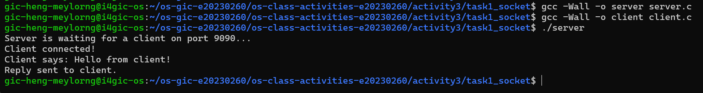
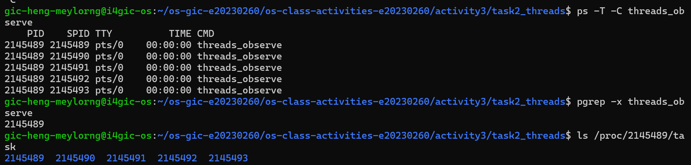
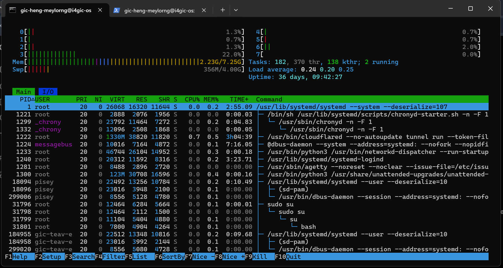
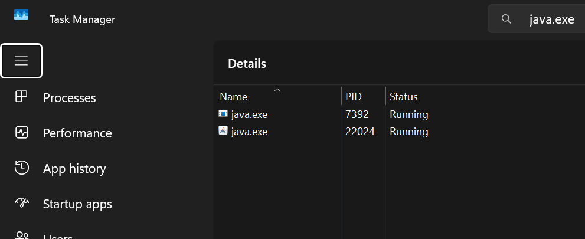

	# Class Activity 3 — Socket Communication & Multithreading

- **Student Name:** Heng Meylorng
- **Student ID:** e20230260
- **Date:** November 13, 2026

---

## Task 1: TCP Socket Communication (C)

### Compilation & Execution

The server and client were compiled successfully using GCC. Port `9090` was used because port `8080` was already in use.



### Result

**Server output:**
```text
Server is waiting for a client on port 9090...
Client connected!
Client says: Hello from client!
Reply sent to client.
```

**Client output:**
```text
Connected to server!
Message sent to server.
Server says: Hello from server!
```

### Answers

**1. What is the role of `bind()` in the server? Why doesn't the client call `bind()`?**

`bind()` assigns a local IP address and port number to the server socket. The server needs this so clients know where to connect. The client usually does not need to call `bind()` because the operating system automatically assigns an available local port when it connects to the server.

**2. What does `accept()` return? How is it different from the original server socket?**

`accept()` returns a new socket file descriptor for communicating with the connected client. The original server socket remains open and continues listening for new connections. The new socket is used to send and receive data with the accepted client.

**3. What happens if you start the client before the server? Try it and describe the error.**

If the client starts before the server is listening, the connection cannot be established. The client will normally display a `Connection refused` error because no server is accepting connections at the specified address and port.

**4. What does `htons(PORT)` do? Why is byte order conversion needed?**

`htons()` means Host To Network Short. It converts a port number from the computer's host byte order to network byte order (big-endian). This is necessary because network protocols use a standard byte order so different computers can communicate correctly.

**5. Draw the sequence of socket calls for both server and client.**

```text
SERVER                              CLIENT
------                              ------
socket()                            socket()
   |                                   |
bind()                                |
   |                                   |
listen()                              |
   |                              connect()
accept() <------ connection ---------|
   |                                   |
read()/recv() <------- send() --------|
   |                                   |
send() -------------> read()/recv()   |
   |                                   |
close()                             close()
```

---

## Task 2: POSIX Threads on Linux (C)

### Output — Without Mutex (Race Condition)



The program created four threads. Each thread tried to increase the same shared counter 100,000 times.

**Observed result:**
```text
Expected counter: 400000
Actual counter: 157795
```

The actual value was smaller than expected because multiple threads accessed and modified the shared counter at the same time.

### Output — With Mutex (Correct)

The mutex version protects the shared counter while a thread updates it.

**Observed result:**
```text
Expected counter: 400000
Actual counter: 400000
```

### Answers

**1. What is a race condition? Why does `shared_counter` produce an incorrect result in `threads.c`?**

A race condition happens when multiple threads access and modify shared data at the same time, and the result depends on the order of execution.

In `threads.c`, several threads increase `shared_counter` simultaneously. Some updates can overwrite other updates, so the final value may be less than 400,000.

**2. What does `pthread_mutex_lock()` do? Why does it fix the race condition?**

`pthread_mutex_lock()` locks a mutex before a thread accesses shared data. Only one thread can enter the protected section at a time. Other threads must wait until the mutex is unlocked.

This prevents multiple threads from updating the counter simultaneously and protects the shared data.

**3. What happens if you forget to call `pthread_join()`? Try removing it and describe the behavior.**

`pthread_join()` makes the main thread wait until a specified thread finishes.

If we remove it, the main thread may finish and the process may terminate before the worker threads complete their work. As a result, some output or calculations may not finish.

**4. How is a thread different from a process? What do threads share and what is private to each thread?**

A process is an independent program in execution, while a thread is a smaller unit of execution inside a process.

Threads in the same process share:
- Code
- Data and heap memory
- Open files

Each thread has its own:
- Stack
- Registers
- Thread ID

---

## Task 3: Java Multithreading

### ThreadDemo Output

The `ThreadDemo` program creates three threads by extending the `Thread` class.

**Observed output:**
```text
Thread 1 is running.
Thread 3 is running.
Thread 2 is running.
Thread 3 finished.
Thread 1 finished.
Thread 2 finished.
```

### RunnableDemo Output

The `RunnableDemo` program creates threads by implementing the `Runnable` interface.

**Observed output:**
```text
Runnable thread 1 is running.
Runnable thread 3 is running.
Runnable thread 2 is running.
Runnable thread 2 finished.
Runnable thread 1 finished.
Runnable thread 3 finished.
```

### PoolDemo Output

The `PoolDemo` program uses a fixed thread pool to manage five tasks with two worker threads.

**Observed output:**
```text
All tasks submitted.
Task 1 is running on pool-1-thread-1
Task 2 is running on pool-1-thread-2
Task 3 is running on pool-1-thread-1
Task 4 is running on pool-1-thread-2
Task 5 is running on pool-1-thread-1
```

### Answers

**1. What is the difference between extending `Thread` and implementing `Runnable`? When would you prefer one over the other?**

Extending `Thread` means creating a new class that inherits from the `Thread` class and overrides its `run()` method.

Implementing `Runnable` means creating a class that defines a task using the `run()` method. The task can then be passed to a `Thread` object.

I prefer `Runnable` when I want to separate the task from the thread because the class can still extend another class. Extending `Thread` is useful for simple examples where I want to customize a thread directly.

**2. In `PoolDemo`, why do only 2 tasks run simultaneously even though 6 are submitted?**

Because the program uses `Executors.newFixedThreadPool(2)`, which creates a pool with only two worker threads. Therefore, only two tasks can execute at the same time. The remaining tasks wait until a worker becomes available.

**3. What does `thread.join()` do in Java? What happens if you remove it from `ThreadDemo`?**

`thread.join()` makes the current thread wait until the specified thread finishes.

If we remove `join()`, the main thread does not wait for the three worker threads. It may print its final message before all worker threads finish.

**4. Why is `ExecutorService` considered better than manually creating threads for large applications?**

`ExecutorService` manages a group of reusable threads. It can reduce the overhead of repeatedly creating new threads, control the number of concurrent tasks, and manage task execution more easily.

---

## Task 4: Observing Threads in Linux & Windows

### Linux — Thread Observation

The `threads_observe` program created four worker threads and one main thread.

**Observed process information:**
```text
PID      SPID
2145489  2145489
2145489  2145490
2145489  2145491
2145489  2145492
2145489  2145493
```

The same five thread IDs were found in `/proc/2145489/task/`:

```text
2145489
2145490
2145491
2145492
2145493
```

This confirms that the process had five threads in total: one main thread and four worker threads.

### Linux — htop Thread View


### Linux — htop Kernel Threads



The htop summary showed approximately 370 total threads and 137 kernel threads during observation. The individual kernel-thread entries were not clearly visible in the tree view in my environment, so I cannot identify three specific kernel threads from my screenshot.

### Windows — Task Manager



I used Windows Task Manager to observe Java processes while a Java program was running. The screenshot shows Java processes and their process information.

### Answers

**1. What does the LWP column mean?**

LWP means Lightweight Process. In Linux, it represents a thread ID. Threads belonging to the same process share the same PID but have different LWP IDs.

**2. How many entries are in `/proc/PID/task/`? What does this tell you?**

There are five entries for PID `2145489`. This tells me that the process contains five threads: one main thread and four worker threads.

**3. Why does a Java program have more threads than the ones you explicitly create?**

A Java program can have additional threads created and managed by the Java Virtual Machine (JVM). These may include garbage collection, compiler, and other background service threads. Therefore, the operating system may show more threads than the ones created directly in the Java source code.

**4. How is viewing threads different between Linux and Windows?**

Linux provides commands and tools such as `ps`, `/proc`, `top`, and `htop` to inspect thread IDs and process information. Windows provides Task Manager to view running processes and related details. Both operating systems allow us to monitor running programs, but their tools display information differently.

**5. What is `kthreadd`? Name three kernel threads.**

`kthreadd` is a Linux kernel process with PID 2. It creates and manages kernel threads.

Examples of kernel threads include:
- `ksoftirqd/0`
- `rcu_sched`
- `kworker`

These are examples from the Linux kernel; I could not confirm all three individually in my htop screenshot.

**6. Why is the TID of the main thread equal to the PID? What do NLWP and PSR mean?**

The main thread is the first thread of a process, so its TID is equal to the process PID.

- **NLWP:** Number of lightweight processes (threads) in the process.
- **PSR:** The CPU core on which a thread last ran.

The number of threads and the number of CPU cores are different things.

**7. What do `H` and `K` do in htop?**

- **H:** Shows or hides user threads belonging to each process.
- **K:** Shows or hides kernel threads.

These options help us observe user-created threads and operating-system kernel threads.

---

## Reflection

Through this activity, I learned how two processes communicate using TCP sockets and how multiple threads can execute within one process.

The most interesting part for me was the race condition. I expected the counter to reach 400,000, but the actual result was much smaller because multiple threads accessed the shared variable at the same time. After using a mutex, the result became correct.

I also learned how to observe threads using Linux commands such as `ps` and `/proc`, and how to use htop to view thread information. Understanding threads at the operating-system level helps me understand how programs execute concurrently, why synchronization is important, and how to avoid problems when multiple threads share data.
