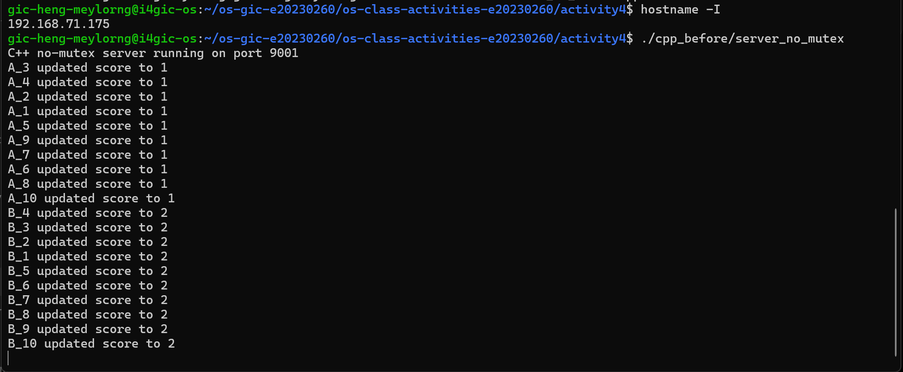
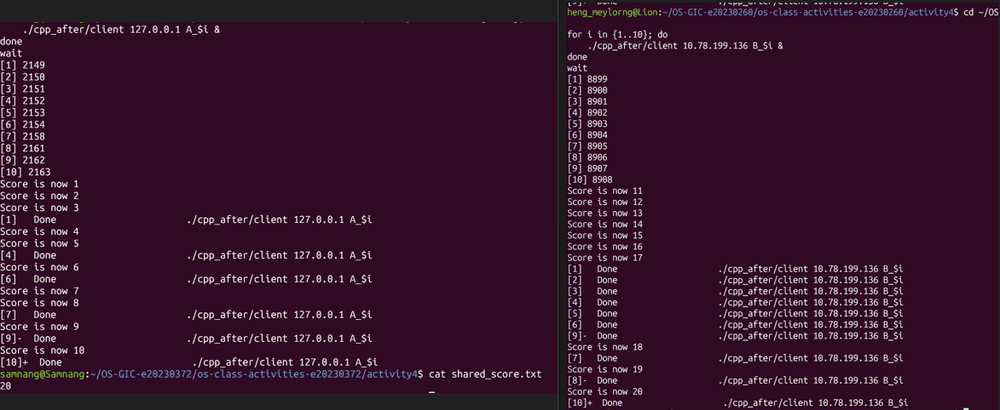
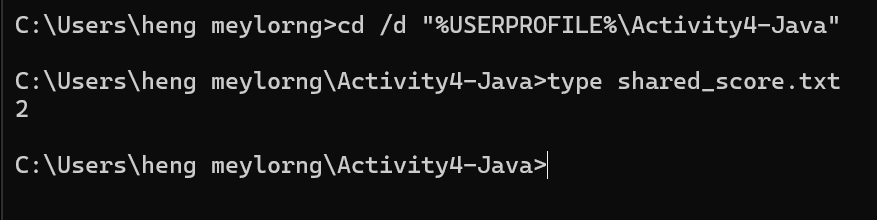
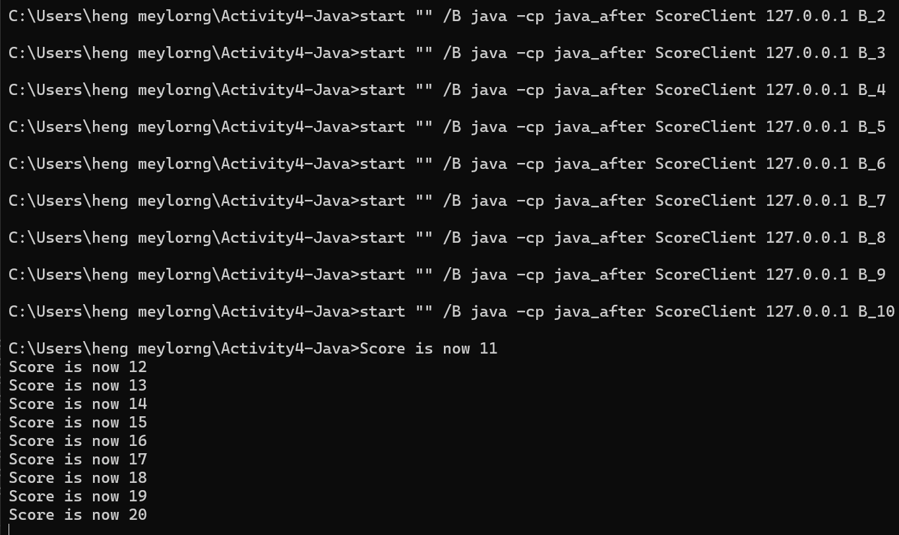

# Class Activity 4 — Shared File API: C++ Mutex & Java `synchronized`

- **Student Name:** Meylorng
- **Student ID:** e20230260
- **Partner Name:** Solo work
- **Partner Student ID:** N/A
- **Server Machine Owner:** Student
- **C++ Server IP:** `192.168.71.175`
- **Java Server:** Localhost (`127.0.0.1`)
- **Date:** November 17, 2026

---

## Task 1: C++ Before Mutex

**Expected score after 20 total client requests:** 20  
**Actual score:** 2

**What happened:**

The C++ server handled multiple client requests using separate threads. However, the program did not use a mutex to protect the shared file. Several threads could read the same old score before updating it. As a result, some updates were lost, and the final score was only 2 instead of 20. This demonstrates a race condition.

### Screenshots

---

## Task 2: C++ After Mutex

**Expected score after 20 total client requests:** 20  
**Actual score:** 20

**What changed after adding mutex:**

I added `std::mutex` and `std::lock_guard<std::mutex>` to protect the score update operation. Only one thread can enter the protected section at a time. Therefore, the threads update the shared file safely without losing updates. The final score became 20.

### Screenshots

-
---

## Task 3: Java Before Synchronized

**Expected score after 20 total client requests:** 20  
**Actual score:** 2

**What happened:**

The Java server created a new thread to handle each client request. However, the `updateScore()` method did not use `synchronized`. Multiple threads could read the same score and overwrite each other's updates. Therefore, the final score was only 2 instead of 20. This demonstrates a race condition in Java.

### Screenshots

- 
---

## Task 4: Java After Synchronized

**Expected score after 20 total client requests:** 20  
**Actual score:** 20

**What changed after adding synchronized:**

I added the `synchronized` keyword to the `updateScore()` method. This allows only one thread at a time to execute the synchronized method on the same class monitor. As a result, the score updates are protected from concurrent access, and the final score is 20.

**Note:** The Java synchronized server used port `19013` instead of `9012` because the original port was already occupied by another application.

### Screenshots

-
---

## Questions

### 1. Why should clients send requests to the server instead of writing the file directly?

Clients should send requests to the server because the server acts as a central controller for the shared file. Only the server updates the file, which makes it easier to manage access and protect the shared resource.

### 2. Why does the server still have a race condition before mutex or synchronized?

The server handles multiple client requests using different threads. These threads may read and update the shared file at the same time. Without synchronization, one thread can overwrite another thread's update, causing lost updates.

### 3. In the C++ fixed version, what does `std::lock_guard<std::mutex>` protect?

`std::lock_guard<std::mutex>` protects the critical section where the server reads, increases, and writes the score. It automatically locks the mutex when entering the scope and unlocks it when leaving the scope.

### 4. In the Java fixed version, what does `synchronized` protect?

The `synchronized` keyword protects the `updateScore()` method. It ensures that only one thread at a time can execute that synchronized method using the same class monitor.

### 5. Why is the final score expected to be 20 when Student A sends 10 requests and Student B sends 10 requests?

The initial score is 0. Student A sends 10 requests, and Student B sends another 10 requests. Each successful request increases the score by 1.

Therefore:

`0 + 10 + 10 = 20`

The expected final score is 20.

### 6. What could happen if two separate servers update the same file at the same time?

Two separate servers could access and update the same file simultaneously. Even if each server uses its own mutex or synchronized method, those synchronization mechanisms do not coordinate with the other server. This could cause race conditions and lost updates. A shared coordination mechanism, such as a database transaction or file lock, would be needed.

---

## Reflection

This activity helped me understand race conditions and the importance of synchronization when multiple threads access a shared resource.

In C++, I used `std::mutex` with `std::lock_guard<std::mutex>` to protect the critical section. In Java, I used the `synchronized` keyword to prevent multiple threads from executing the protected method at the same time.

Both approaches help prevent lost updates and keep the final score correct.

I also learned that using a server to control a shared file does not automatically prevent race conditions. The server still needs synchronization because it can handle multiple client requests concurrently.

**Testing note:** I worked individually using two simulated clients (Student A and Student B) on one laptop rather than two separate student machines. The tests demonstrated concurrent client requests to the server.

