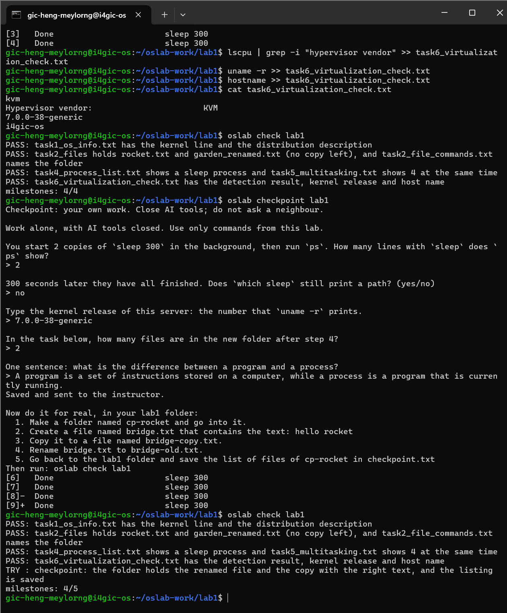
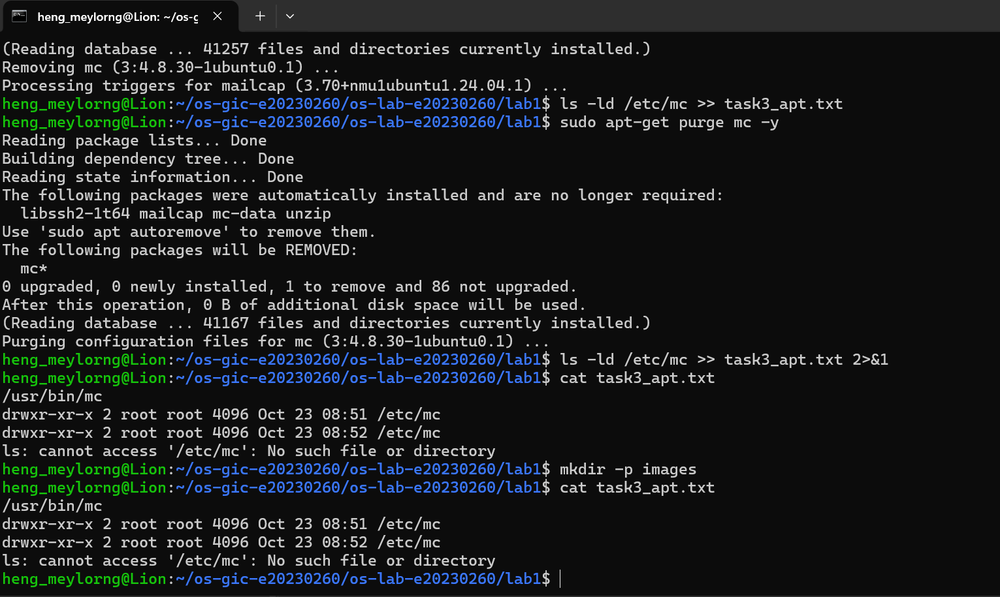
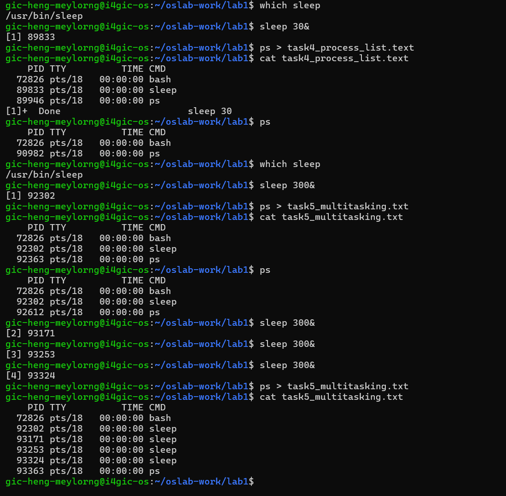
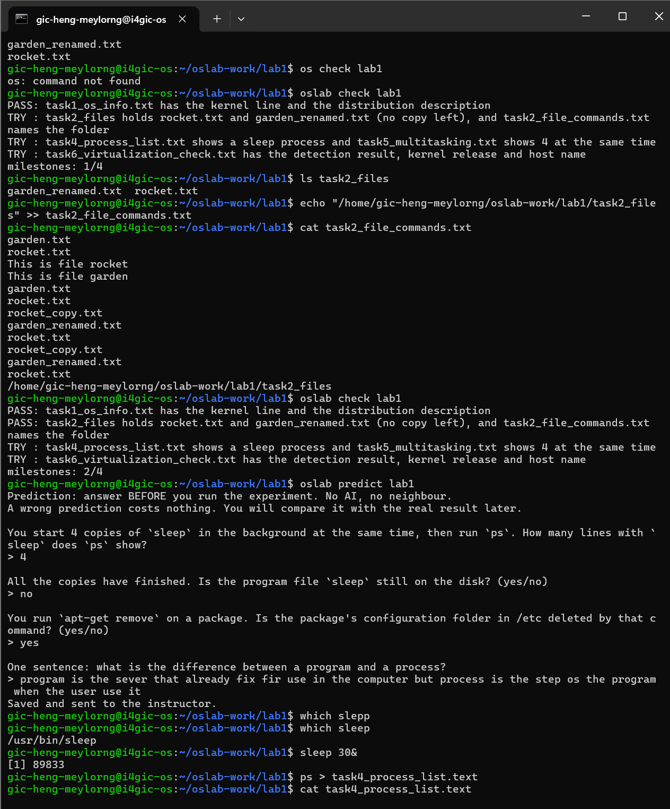

# Operating Systems Lab 1

**Student ID:** e20230260  
**Student Name:** heng meylorng  
**Course:** Operating Systems  
**Environment:** Ubuntu 24.04 (WSL) and Ubuntu 26.04.1 (Remote Server)

## Task 1: System Information
Collected operating system and system information.
Screenshot: Not included.

## Task 2: File Commands
Practiced file and directory commands, including renaming files.
Screenshot: 

## Task 3: Package Management
Installed, removed, and purged the `mc` package using APT. Removing the package left its configuration directory, while purging removed it.
Screenshot: 

## Task 4: Process Management
Recorded process information using Linux process commands.
Screenshot: 

## Task 5: Multitasking
Recorded running processes, including multiple `sleep` processes.
Screenshot: Not included.

## Task 6: Virtualization
Checked virtualization-related information.
Screenshot: 
